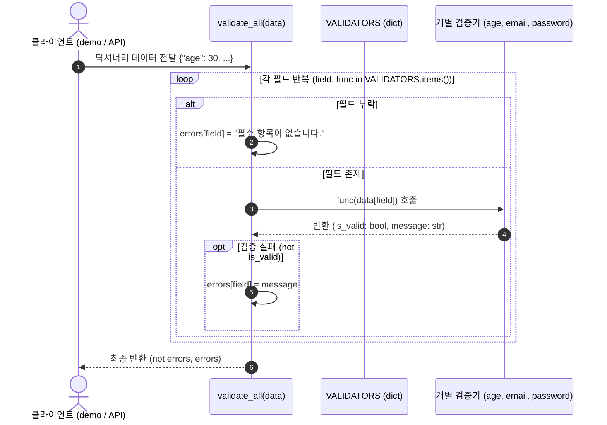

# 시스템 아키텍처 및 설계 결정 (Architecture & Design Record)

## 1. 개요 (Overview)
본 프로젝트(`python-basics-01`)는 파이썬의 기본 언어 명세(데이터 모델, 객체 바인딩, 가변성, 진리값 판정, 함수 일급 객체)를 검증하고, 이를 활용하여 안정적이고 재사용 가능한 실무형 입력값 검증 엔진(`validator.py`)을 구축하는 프로젝트입니다.

---

## 2. 모듈 구조 및 관계 (Module Structure & Relationships)

```mermaid
flowchart TD
    subgraph Core[검증 엔진 (Core Engine)]
        V[validator.py]
        VA[validate_age]
        VE[validate_email]
        VP[validate_password]
        VT[VALIDATORS Dispatch Table]
        VAll[validate_all]
        
        V --> VA
        V --> VE
        V --> VP
        VT --> VA
        VT --> VE
        VT --> VP
        VAll --> VT
    end

    subgraph Client[실행 및 검증 클라이언트]
        D[demo.py] --> VAll
        T[test_validator.py] --> VAll
        T --> VA
        T --> VE
        T --> VP
    end

    subgraph Lab[언어 명세 실험실]
        E[experiments.py]
    end
```

---

## 3. 데이터 및 검증 처리 흐름 (Data Flow)



---

## 4. 아키텍처 설계 결정 (Architecture Decision Records - ADR)

### ADR-1: 반환 규약 `(bool, str)` 튜플 채택
- **결정**: 모든 단일 검증 함수는 `(성공 여부: bool, 메시지: str)` 형태의 불변 튜플을 반환한다.
- **이유**: 성공 시 `(True, "OK")`, 실패 시 `(False, "에러 원인")`으로 일관된 시그니처를 유지하여 호출자가 예외 처리(`try-except`) 비용 없이 직관적으로 언패킹하여 처리할 수 있습니다.

### ADR-2: 일급 객체 기반 디스패치 테이블 (`VALIDATORS` 딕셔너리)
- **결정**: `if-elif` 체인 대신 필드명을 키로, 함수 객체를 값으로 갖는 딕셔너리 테이블 패턴을 적용한다.
- **이유**: Open-Closed Principle(개방 폐쇄 원칙)을 준수하여 추후 새로운 필드 검증 함수가 추가되더라도 `validate_all` 본문을 수정할 필요 없이 딕셔너리에 매핑만 추가하면 확장이 가능합니다.

### ADR-3: 키워드 전용 인자(`*`)를 통한 옵션 플래그 강제
- **결정**: `validate_password`의 `require_digit`, `require_alpha` 플래그는 `*` 뒤에 배치하여 키워드 인자로만 호출하도록 제한한다.
- **이유**: `validate_password("pass", 8, True, False)`처럼 불리언 플래그가 연속되면 가독성이 떨어지고 순서 실수가 발생하기 쉽습니다. 키워드를 강제함으로써 `require_digit=False`와 같이 의도를 명확하게 코드에 드러냅니다.

### ADR-4: `bool`과 `int` 상속 관계 방어
- **결정**: `validate_age`에서 `isinstance(age, int)` 검사 시 `isinstance(age, bool)`을 명시적으로 거부한다.
- **이유**: 파이썬에서 `bool`은 역사적으로 `int`의 서브클래스(`issubclass(bool, int) is True`)이므로, `isinstance(True, int)`는 `True`를 반환합니다. 따라서 불리언 값이 정수 나이로 통과하는 버그를 원천 차단합니다.
